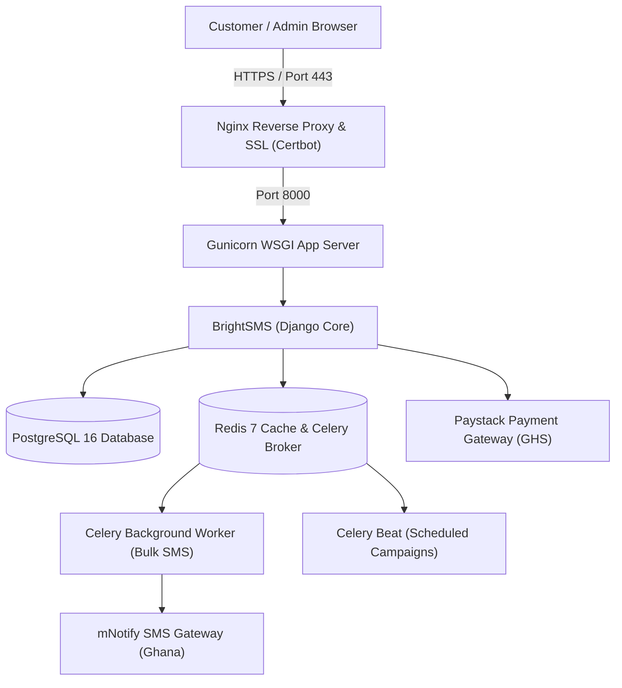

# Production Readiness Roadmap & Deployment Runbook

This guide outlines every technical, operational, and financial step required to deploy **BrightSMS** to a live production environment.

---

## 1. Production Architecture Overview



---

## 2. Technical Hardening Checklist

### A. Environment Configuration (`.env`)
In production, update your `.env` with strict production values:
- [ ] Set `DEBUG=False`.
- [ ] Generate a cryptographically secure `SECRET_KEY`:
  ```bash
  python -c "import secrets; print(secrets.token_urlsafe(50))"
  ```
- [ ] Set `ALLOWED_HOSTS=yourdomain.com,www.yourdomain.com`.
- [ ] Set `PAYMENT_SANDBOX_MODE=False` (when live Paystack merchant account is approved).
- [ ] Configure PostgreSQL credentials:
  ```env
  DB_ENGINE=django.db.backends.postgresql
  DB_NAME=brightsms_prod
  DB_USER=brightsms_user
  DB_PASSWORD=your_strong_db_password
  DB_HOST=127.0.0.1
  DB_PORT=5432
  ```

### B. Security Headers & Cookies
When `DEBUG=False`, ensure these security headers are active in `config/settings.py`:
- [ ] `SECURE_SSL_REDIRECT = True` (routes all HTTP traffic to HTTPS)
- [ ] `SESSION_COOKIE_SECURE = True` (cookies only transmitted over HTTPS)
- [ ] `CSRF_COOKIE_SECURE = True`
- [ ] `SECURE_HSTS_SECONDS = 31536000` (Strict-Transport-Security)
- [ ] `SECURE_HSTS_INCLUDE_SUBDOMAINS = True`
- [ ] `SECURE_HSTS_PRELOAD = True`

### C. Static & Media Files
- [ ] Run `python manage.py collectstatic --noinput`
- [ ] Use `whitenoise` or Nginx `alias /app/staticfiles/;` for high-performance static asset caching.

---

## 3. External Service Onboarding

### A. SMS Gateway (mNotify / BMS)
- [ ] Verify you have sufficient prepaid balance on your mNotify wallet (your current balance is **266 credits**).
- [ ] Register your production Sender IDs (e.g. `BrightSMS` or your customers' brand names) with the National Communications Authority (NCA) through mNotify's dashboard.
- [ ] Set up an mNotify webhook for Delivery Receipts (DLR) to update message delivery statuses in real time.

### B. Payment Provider (Paystack)
- [ ] Complete Paystack Compliance & Business Verification (Ghanaian business registration or national ID).
- [ ] Add your live API keys to `.env`:
  ```env
  PAYSTACK_PUBLIC_KEY=pk_live_...
  PAYSTACK_SECRET_KEY=sk_live_...
  ```
- [ ] Configure the live Webhook URL in your Paystack Dashboard:
  `https://yourdomain.com/billing/webhook/paystack/`

### C. Transactional Email Service
For password resets, verification emails, and invoice notifications:
- [ ] Set up an SMTP provider (e.g., SendGrid, Postmark, Amazon SES, or Brevo).
- [ ] Configure in `.env`:
  ```env
  EMAIL_BACKEND=django.core.mail.backends.smtp.EmailBackend
  EMAIL_HOST=smtp.sendgrid.net
  EMAIL_PORT=587
  EMAIL_USE_TLS=True
  EMAIL_HOST_USER=apikey
  EMAIL_HOST_PASSWORD=your_sendgrid_key
  DEFAULT_FROM_EMAIL=noreply@yourdomain.com
  ```

---

## 4. Hosting & Infrastructure Options

### Option 1: Docker Compose on a Cloud VPS (Recommended for cost & control)
*Providers: DigitalOcean ($12/mo Droplet), Linode, Hetzner, or AWS Lightsail*
1. Install Docker & Docker Compose on Ubuntu 24.04:
   ```bash
   sudo apt update && sudo apt install -y docker.io docker-compose
   ```
2. Clone repository & add `.env`.
3. Launch stack:
   ```bash
   docker-compose up -d --build
   ```
4. Set up Nginx reverse proxy with SSL via Certbot:
   ```bash
   sudo apt install -y certbot python3-certbot-nginx
   sudo certbot --nginx -d yourdomain.com
   ```

### Option 2: Managed PaaS (Simplest deployment, zero server maintenance)
*Providers: Render.com or Railway.app*
1. Connect GitHub repo to Render / Railway.
2. Add Managed PostgreSQL and Redis plugins.
3. Configure environment variables in the dashboard.
4. Set build command: `pip install -r requirements.txt && python manage.py collectstatic --noinput && python manage.py migrate`
5. Set start command: `gunicorn config.wsgi:application --bind 0.0.0.0:$PORT --workers 3`

---

## 5. Automated Backups & Maintenance

### Daily Database Backup Cron Job
Create a script `/opt/backup_db.sh`:
```bash
#!/bin/bash
BACKUP_DIR="/var/backups/brightsms"
DATE=$(date +\%Y\%m\%d_\%H\%M\%S)
mkdir -p $BACKUP_DIR
pg_dump -U brightsms_user -h localhost brightsms_prod | gzip > "$BACKUP_DIR/db_$DATE.sql.gz"
# Keep only last 14 days of backups
find $BACKUP_DIR -type f -name "*.sql.gz" -mtime +14 -delete
```
Make executable and add to crontab:
```bash
chmod +x /opt/backup_db.sh
# Run nightly at 2:00 AM
crontab -e
0 2 * * * /opt/backup_db.sh
```

---

## 6. Scheduled Campaigns Worker

If running without Celery, run the built-in management command every minute via cron:
```bash
* * * * * cd /app && /app/venv/bin/python manage.py process_scheduled_campaigns >> /var/log/scheduled_campaigns.log 2>&1
```
If running with Celery, `celery -A config beat` handles this automatically using `messaging.tasks.process_scheduled_campaigns_task`.

---

## 7. Pre-Launch Verification Checklist

- [ ] All 14 tests pass (`python manage.py test`).
- [ ] Django checks pass (`python manage.py check --deploy`).
- [ ] Test customer registration, CSV import, and single SMS dispatch with real recipient.
- [ ] Verify test purchase in Paystack live mode.
- [ ] Verify terms of service and privacy policy pages reflect Ghanaian Data Protection Commission (DPC) guidelines.
